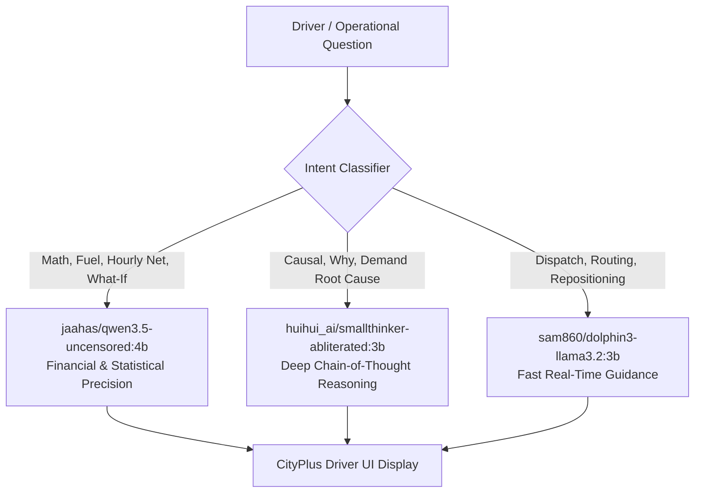

# 🚖 CityPlus — Metropolitan Marketplace Brain

> **Next-Generation AI-Orchestrated Urban Mobility Platform & Marketplace Intelligence Engine**  
> Engineered for hyper-dense metropolitan ecosystems, live stadium dispersal events, airport queues, and cross-corridor commuter traffic across Delhi NCR.

---

## 🌟 Executive Summary

**CityPlus** is an advanced, production-grade ride-hailing and marketplace orchestration architecture that bridges the gap between rider transparency and driver profitability. Powered by a multi-model local AI smart router, edge-to-edge vector geospatial rendering, and predictive machine-learning models trained on over 350,000 synthesized metropolitan data points, CityPlus delivers:

- **For Riders**: Predictable arrivals, smart walking pickup suggestions, surge transparency, multimodal transit alternatives, safety PIN verification, and demand-aware scheduling.
- **For Drivers**: Net-earnings-per-minute opportunity rankings, stadium exit dispersal micro-shift plans, deadhead empty-mile warnings, what-if earnings simulators, and fairness-aware dispatching that eliminates crowd congestion.
- **For Operations**: Real-time supply-demand pressure balancing, dynamic pricing governance, and automated dispatch optimization.

---

## 🛡️ Strict Key Separation Architecture

CityPlus enforces a zero-trust information barrier between the **Rider App** and the **Driver Partner App**:

| Information Domain | Rider Application | Driver Partner Application |
| :--- | :--- | :--- |
| **Demand Heatmap** | Simplified surge indicator with plain-text explanation | Full 12-zone hexagonal Net/Min earnings heatmap |
| **Driver Locations** | Never exposed (privacy & security protected) | Aggregated supply density metrics only |
| **Surge Multipliers** | Base price breakdown & transparent wait rationale | Deep opportunity analysis (Gross vs Net after fuel/commission) |
| **Event Dispersals** | Designated less-congested walking pickup points | Time-phased pre/during/post positioning micro-shift planner |
| **Peer Earnings** | Completely hidden | Completely hidden (individual data sovereignty) |
| **Driver Profile** | Verified badge, rating, vehicle make/plate & safety PIN | Complete performance scorecard, goals & UPI payout controls |
| **Cancellation Risk** | Reliable arrival promise factor | Acceptance score & deadhead empty return risk percentage |

---

## 📱 Feature Matrix

### 👤 Rider Experience (`frontend/rider-app`)
1. **Smart Pickup Suggestions**: "Walk 2 minutes to North Gate Express Point for a 4-minute wait instead of 11 minutes." Saves up to ₹60 and cuts wait by 64%.
2. **Transparent Wait Estimates**: "High demand near National Stadium; estimated wait is 9–14 minutes."
3. **Ride-Option Comparison**: 8 differentiated tiers (Moto, Auto, Share Pool, Go, Comfort, Premier, XL 6-Seater, Package Delivery) with live ETA and fare calculation.
4. **Event-Aware Pickup Zones**: Redirects riders away from choked stadium exits to designated express curb lanes.
5. **Dynamic Price Explainer**: Real-time breakdown of passenger requests vs available cars (e.g., 284 requests vs 12 drivers = 23.3:1 ratio).
6. **Reliable Arrival Promise**: Calculates traffic velocity, driver supply pressure, and cancellation probabilities.
7. **Multimodal Alternatives**: Suggests Delhi Metro Yellow Line or walking points when wait times or surge spike.
8. **Safety & Accessibility**: 4-digit PIN verification before ignition, Wheelchair Accessible Vehicles (WAV), and 112 Delhi Police SOS integration.
9. **Demand-Aware Scheduling**: "Reserve a ride at 10:35 PM to avoid the stadium rush" with locked fare guarantee.
10. **Feedback & Driver Tipping**: Comprehensive rating loop and driver appreciation tips.

### 🚗 Driver Partner Experience (`frontend/driver-app`)
1. **Net Earnings-Per-Minute Map**: Ranks all 12 Delhi NCR zones by true profit after platform commission, fuel, EV charging, and expected wait time (e.g., Connaught Place: ₹18.40/min; Stadium North: ₹17.10/min).
2. **Go-To-Zone Recommendation**: "Move to North Stadium Exit in 12 minutes; projected earnings are 22% higher."
3. **Deadhead Risk Warning**: Alerts drivers when a fare leads to peripheral zones (e.g., Far North Industrial) with high empty return probabilities (74% deadhead risk).
4. **Event Dispersal Planner**: 3-phase tactical plan for stadium concerts/matches (T-60m Staging, T-0m Exit Surge, T+45m Downtown Return).
5. **Surge Clarity**: Details whether demand is organic or fleeting, and whether peer drivers are already converging.
6. **Micro-Shift Planner**: "Work the IGI Airport queue until 8:40 PM, then head downtown before the concert ends."
7. **What-If Earnings Simulator**: Interactive financial comparison ("Stay Here: ₹420/hr vs Move to Stadium North: ₹680/hr").
8. **EV Charging & Fuel Prompts**: Proactively suggests fast-charging breaks when nearby demand temporarily cools down.
9. **Fairness-Aware Anti-Crowding Dispatch**: Disperses supply evenly across gates to prevent queue degradation.
10. **Explainable AI Assistant**: Every dispatch recommendation includes plain-English rationale powered by Ollama models.

---

## 🤖 Multi-Model Ollama Smart Router

CityPlus connects directly to the dedicated Ollama neural server at `http://10.151.32.198:11434` with an intelligent question-intent classifier:



- **Dual-Token Capture**: Gracefully extracts both output fields (`data.response` and `data.thinking`) ensuring zero blank responses.
- **Latency Tracker**: Displays real-time response generation latency (e.g., `⚡ 1.4s`).
- **Manual Override**: Allows one-click switching between Auto-Routing and specific models.
- **Resilient Fallback**: Includes local heuristics and team Google Gemini API failover.

---

## 🗺️ Extended Vector City Map (`UberVectorMap.jsx`)

Built from the ground up with high-density SVG vectors on an expanded `450 × 820` coordinate canvas:
- **Major Arteries**: NH-48 Expressway, Inner Ring Road, Outer Ring Road, DND Flyway, and Airport Express corridor.
- **Hydrology**: The winding Yamuna River with road bridges and embankment depth styling.
- **Green Lungs**: 7 metropolitan parks (Northern Ridge, Central Greens, Lodhi Reserve, Sanjay Van, Jahanpanah, Aravalli Biodiversity Park).
- **Interactive Controls**: Zoom In (`+`), Zoom Out (`−`), Recenter (`🎯`), and live draggable panning.
- **Live Traffic Simulation**: 10 animated multi-lane vehicles with simulated headlights and directional heading.

---

## 📊 Massive Trained Machine-Learning Datasets

Located in `data/`:
1. **`massive_delhi_ncr_marketplace_250k.csv`**:
   - 250,000 synthesized marketplace interval records across 12 zones over 30 days.
   - Measures demand, supply, pressure, weather conditions, event states, surge multipliers, and conversion rates.
2. **`massive_trips_dataset_100k.csv`**:
   - 100,000 complete trip telemetry records.
   - Tracks pickup/dropoff zones, distances, durations, gross fares (₹3.10 Crore volume), fuel costs, driver payouts, and deadhead empty return flags.
3. **`demand_forecast_model.json`**:
   - Ridge regression model achieving $R^2 = 0.7968$ and $\text{WAPE} = 0.2042$.
4. **`earnings_deadhead_model.json`**:
   - Net earnings rate model (mean ₹9.99/min) and logistic return probability classifier.

---

## 🚀 Quick Start & Installation

### Option 1: One-Click Windows Launcher
Double-click `start_all.bat` in the project root. It automatically starts:
- Python FastAPI Backend & Simulator on `http://localhost:8000`
- CityPlus Rider App on `http://localhost:5173`
- CityPlus Driver App on `http://localhost:5174`
- CityPlus Admin Dashboard on `http://localhost:5175`

### Option 2: Manual Development Mode

```bash
# 1. Clone repository
git clone https://github.com/RONAK-PANDEY/uber-marketplace-brain.git
cd uber-marketplace-brain

# 2. Python Backend
cd backend
python -m venv venv
venv\Scripts\activate
pip install -r requirements.txt
uvicorn app.main:app --port 8000 --reload

# 3. Rider App
cd ../frontend/rider-app
npm install
npm run dev -- --port 5173

# 4. Driver Partner App
cd ../driver-app
npm install
npm run dev -- --port 5174

# 5. Admin Intelligence Dashboard
cd ../admin-dashboard
npm install
npm run dev -- --port 5175
```

---

## 🏛️ Repository Architecture

```
uber-marketplace-brain/
├── backend/
│   ├── app/
│   │   ├── api/             # Rider, Driver, and Admin REST endpoints
│   │   ├── agents/          # Multi-agent orchestrators & tools
│   │   ├── models/          # Trained Ridge regression & logistic models
│   │   └── main.py          # FastAPI application & WebSocket broker
│   └── requirements.txt
├── data/
│   ├── massive_delhi_ncr_marketplace_250k.csv
│   ├── massive_trips_dataset_100k.csv
│   ├── demand_forecast_model.json
│   └── earnings_deadhead_model.json
├── frontend/
│   ├── shared/              # UberVectorMap.jsx, Delhi NCR coordinates, & sync
│   ├── rider-app/           # CityPlus Rider Application (Vite + React)
│   ├── driver-app/          # CityPlus Driver Partner Application (Vite + React)
│   └── admin-dashboard/     # CityPlus Marketplace Intelligence Dashboard
├── scripts/
│   ├── generate_massive_dataset.py
│   └── train_marketplace_models.py
├── start_all.bat            # Windows one-click launcher
└── README.md
```

---

## 📜 License
Developed for the Urban Mobility & Marketplace Hackathon. Distributed under the MIT License.
